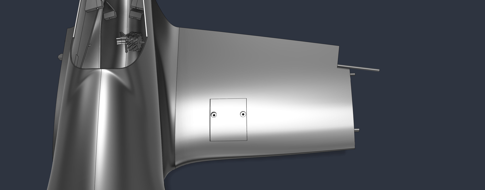

Step 1:
Printing all necessary parts.
Use the bambu slicer file or print the parts using the 3d model.
This step will probably take several days.

Step 2:
Setting up the electronics.

Deconstruct the MS18 servo and take the potentiometer, motor and pcb out.

Solder 10cm long wires from the motor to the servo-pcb and the same for the potentiometer.

Solder a 9v-battery connector to a wire and then on the voltage step-down converter, then solder two female headers for each output vcc and gnd on the converter.

Solder the pins on pcb and esp32 if necessary - socket strips for esp32 and antenna (both on on pcb), pin headers for the rest.

Step 3:
Preparing and assymbling the rest of the hardware-stuff.

Insert the heat-brass inserts:

4x M3 in the cross of the nose part, 2x M4 in the nose part, 4x M2 in the electronics-tray, 2x 2mm in each wing beside servo.

Once finished, screw the pcb on the electronics-tray, with the ESC-pins facing towards the arms of the electronics-tray using M2 screws.

Screw the motor on the nose using M3 screws.

Cut the 2,6mm spring steel wire into 2x 27,25cm ; 2x 6,5cm and 1x 23,7cm pieces.

Cut the 1,5mm wire into 2x 1,28mm and 1x 4mm pieces.

Cut the carbon tube into one 24cm piece.

Bend the 1,5mm x 4mm wire piece, so the small wheel can sit at the bottom of a wire in the form of a "U" , with 1,5cm pointing away from the wheel on both sides.

Bend the two 6,5cm long 2,6mm wire pieces around the 5cm mark, so there is a 90° angle.

Make dents on the parts of the wire pieces, where they are attached to something:

The last cm on the 27,25cm pieces and 4cm on the other ends.
About 5mm in the middle of the 23,7cm piece and 2cm on both ends.
The long ends of the bent pieces, aswell as the very end of the short part.

Shove the long end of the bent wire pieces in the hole of the gearstick with hot glue; make sure there is a 90° angle on both sides of the bent pice relative to the gearstick.

Put the gearstick on the servos head and screw it thight with the screws of the servo, so that the servos position is 180°, when the gearstick is at a downwards 90° angle relative to the servo.

Screw the servos in the wings using one 3D-print screw on the accessible side with the gear already attached to them.

Screw the servo cover on, using M2 screws.
Do the same on the other wing.

Put the wheels on the gears and secure them by adding hot glue on the end of the rest of wire looking out.

Funnel the servos headers through the small rectangular opening in the wing structure.

Glue the twirly gears with the small nub on the end of the 27,25cm with 1cm of dents.

Shove the carbon tube into one of the wings trough the hole in the structure, place the wing on the correct side of the planes hull-middle-piece and align the edges.
Shove the 27,25cm wire piece through the small hole at the wings back with the twirly gear inside the hull and laid on the small structure in the hulls middle.

Then shove the other wing on the carbon tube thats looking out the other side and add the other 27,25cm wire pice in the same way as the first one.

Once everything is aligned, glue the wings and hull together with the 3D-print glue.

Then align the wings edge-pieces and glue them on their correct wing with the 3D-print glue.

Align the back part of the hull with the middle part and glue them together using the 3D-print glue.

