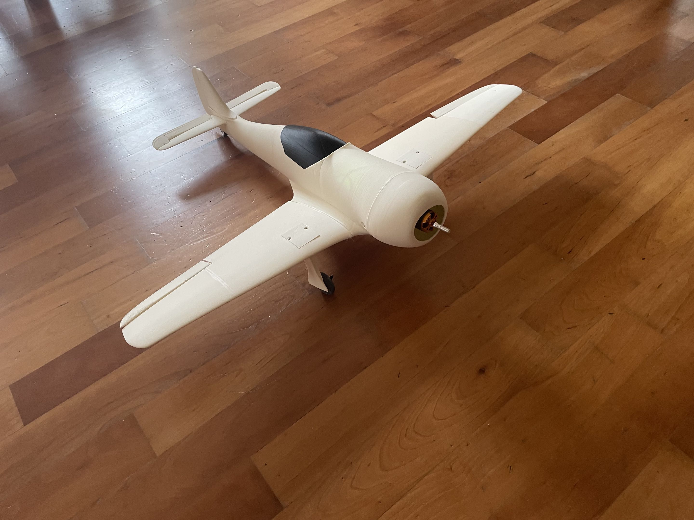

                                                   FW 190 - RC Airplane

A DIY 3D-printable airplane with the looks of the german WW2 fighter FW190.
On here you can find everything necessary to build one yourself, aswell as a description of the planes functions.

How the plane works:

-An ESP32 S3 CAM hosts a controller, reads its data and then sends the wanted controllerdata to another ESP32 S3 CAM per radio.

-The receiving ESP32 sits on a pcb on an electronics tray inside the plane, it processes the incoming radio signals and outputs them to the wanted servo in the plane.

-The airplane itself has retractable gears, two aileroins with one servo each, elevator flaps and a motor.

-The aileroins can be used as an airbrake.

-There is no controllable rudder, becuase it is not necessary for flight, and there was too little space on the axis of the rudder to place any functioning component.

-The electronics tray on which the pcb is mounted is fully removable and holds the battery and ESC-controller.

!!!The airplane is not 100% finished - the elevator flap mechanism is designed but not built to completion!!!
         Completion of the unfinished parts on this repository will follow when airplane is polished

For anyone reviewing this on stardance:
The back steering mechanism is not fully finished, which is why there is no actual footage of the plane flying yet.
The reason for that, is because the potentiometer used in that mechanism was too rigid, so no gears would turn or the servomotor would not stop spinning because of a lack of feedback. (When testing with other potentiometer the mechanism worked)
After one successful test a failed one followed, so I changed the potentiometer because I suspected it was broken. Then I glued the new one in, thinking it would work, but it didn't and now im left with a practically unfunctional potentiometer glued to a part I cannot reprint because of lack of filament. So much to explaining why it is not fully finished.
